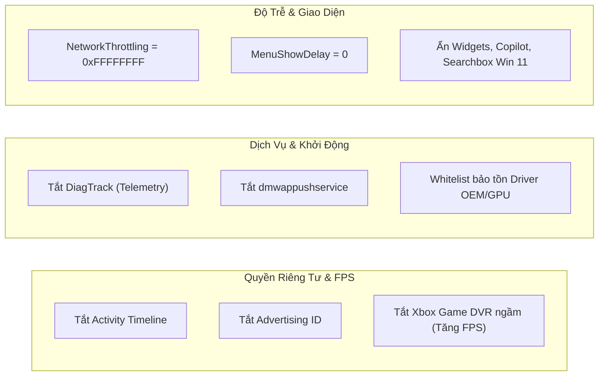
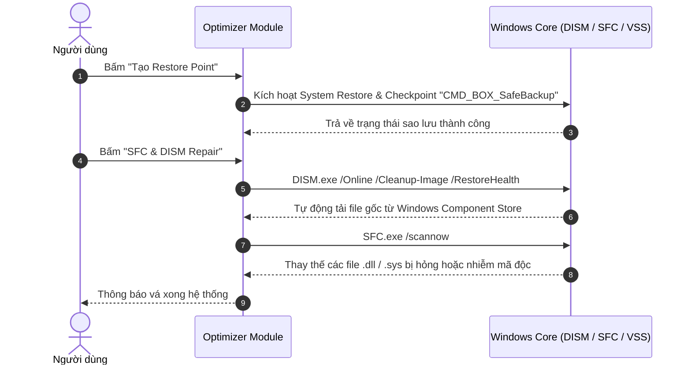

# Kiến Trúc & Sơ Đồ Tính Năng Module System Optimizer (CMD BOX GUI)

Tài liệu này tổng hợp toàn bộ các tính năng, cơ chế vận hành, tác động hệ thống và sơ đồ phân nhóm cho module **System Optimizer** trong ứng dụng **CMD BOX GUI**.

---

## 1. Sơ Đồ Cấu Trúc Tổng Thể (Feature Architecture)

```mermaid
graph TD
    A["System Optimizer"] --> B["1. Dọn Dẹp Ổ Đĩa & Cache (Disk & Cache)"]
    A --> C["2. Tối Ưu Hiệu Năng & Riêng Tư (Performance & Privacy)"]
    A --> D["3. Cứu Hộ & Sửa Lỗi Hệ Thống (Diagnostics & Rescue)"]

    B --> B1["Quick Clean (Xóa rác nhanh)"]
    B --> B2["Deep Clean PRO (Dọn sâu đa tầng)"]
    B --> B3["Windows.old Clean (Dọn bản cài cũ)"]
    B --> B4["Dev Cache Purge (Cache lập trình)"]
    B --> B5["Browser Cache Purge (Cache 8 trình duyệt)"]

    C --> C1["Startup Optimizer (Tối ưu khởi động)"]
    C --> C2["Disable Telemetry (Tắt theo dõi ngầm)"]
    C --> C3["Privacy & Game DVR (Tăng FPS, tắt ghi ngầm)"]
    C --> C4["Win 11 Taskbar Tweaks (Gọn Taskbar)"]
    C --> C5["Low Latency Turbo (Giảm độ trễ)"]

    D --> D1["Tạo Restore Point (Điểm khôi phục)"]
    D --> D2["SFC & DISM Repair (Vá file hệ thống)"]
    D --> D3["Fix Windows Update (Sửa kẹt cập nhật)"]
    D --> D4["Tạm Dừng / Khôi Phục Update (Pause / Resume)"]
```

---

## 2. Phân Tích Chi Tiết Từng Nhóm Tính Năng

### Nhóm 1: Dọn Dẹp Ổ Đĩa & Bộ Nhớ Đệm (Disk Cleanup & Cache Purge)

| Tên Tính Năng | Mục Tiêu & Vùng Tác Động | Độ An Toàn | Quyền Yêu Cầu |
| :--- | :--- | :---: | :---: |
| **Quick Clean** | Dọn sạch thư mục `%TEMP%`, `C:\Windows\Temp`, Recent items, DirectX Shader Cache (`D3DSCache`), CrashDumps, làm sạch Thùng rác (Recycle Bin) và xóa DNS cache. | Tuyệt đối an toàn (10/10) | Standard User |
| **Deep Clean PRO** | Quét hơn 20+ vị trí ngầm: Prefetch, WinSxS Component Store (DISM), Delivery Optimization cache, Event Logs, Windows Error Reporting (`WER`), BSOD Minidumps, Cryptnet SSL Caches, Driver logs. | An toàn cao (9.5/10) | Standard / Admin |
| **Clean Windows.old** | Dọn dẹp thư mục `C:\Windows.old`, `C:\$Windows.~BT`, `C:\$Windows.~WS` sau khi nâng cấp Windows. Giải phóng từ **15GB đến 40GB+**. | Cần xác nhận trước khi chạy (Mất khả năng rollback bản cũ) | RunAsAdmin |
| **Dev Cache Purge** | Thu hồi bộ nhớ đệm của các công cụ lập trình: NPM, Yarn, Pip (Python), NuGet, Gradle, Cargo (Rust), Composer (PHP). | Rất an toàn (9.5/10) | Standard User |
| **Browser Cache Purge** | Quét và dọn sạch cache của 8 trình duyệt phổ biến: Chrome, Edge, Brave, Cốc Cốc, Firefox, Opera, Vivaldi, Arc. Giữ lại Cookie/Mật khẩu lưu. | Rất an toàn (10/10) | Standard User |

---

### Nhóm 2: Tinh Chỉnh Hiệu Năng & Quyền Riêng Tư (Performance Turbo & Privacy)

- **Startup Optimizer**: Quét qua Registry Run Keys (`HKCU` & `HKLM`), vô hiệu hóa các ứng dụng tự khởi động không cần thiết nhưng **tự động bảo vệ danh sách Whitelist** (Driver âm thanh Realtek, cạc đồ họa NVIDIA/AMD/Intel, phần mềm gõ tiếng Việt UniKey/EVKey).
- **Disable Telemetry**: Vô hiệu hóa `Connected User Experiences and Telemetry` (`DiagTrack`), `dmwappushservice`, dịch vụ bản đồ `MapsBroker`, giúp giảm lượng ghi ổ cứng SSD và giải phóng RAM ngầm.
- **Privacy & Game DVR**: Tắt tính năng tự động ghi video màn hình nền ngầm của Windows Game Bar (giúp card màn hình không bị drop FPS khi chơi game), tắt thu thập vị trí và mã quảng cáo cá nhân.
- **Win 11 Taskbar Tweaks**: Tinh chỉnh giao diện Windows 11 bằng cách ẩn các icon thừa trên thanh tác vụ: hộp tìm kiếm khổng lồ (Searchbox), bảng tin rác Widgets, nút Copilot, Chat Teams.
- **Low Latency Turbo**: Tối ưu độ trễ xử lý màn hình Desktop (`MenuShowDelay` về 0), tắt giới hạn băng thông mạng chơi game của Windows (`NetworkThrottlingIndex`), tắt chế độ ngủ đông (`powercfg -h off`) để thu hồi file `hiberfil.sys` nặng bằng dung lượng RAM.

---

### Nhóm 3: Cứu Hộ & Chẩn Đoán Hệ Thống (System Rescue & Diagnostics)

- **Tạo Restore Point**: Tạo điểm sao lưu dự phòng cho Registry và tệp hệ thống ngay lập tức trước khi thực hiện các tinh chỉnh lớn.
- **SFC & DISM Repair**: Giải pháp 2 tầng tiêu chuẩn vàng của Microsoft để sửa lỗi màn hình xanh (BSOD), file DLL bị mất, hoặc lỗi crash ứng dụng ngẫu nhiên.
- **Fix Windows Update**: Tự động dừng các dịch vụ `wuauserv`, `bits`, `cryptsvc`, xóa sạch bộ nhớ đệm tải về bị lỗi kẹt ở `C:\Windows\SoftwareDistribution` và đăng ký lại DLL cập nhật.
- **Tạm Dừng / Khôi Phục Update**: Dừng ép cập nhật đột ngột (hoãn đến 2038) hoặc bật lại bình thường chỉ với 1 cú click.

---

## 3. Kiến Trúc UI Tối Ưu Hiện Đại (Cải Tiến Giao Diện)

Trong phiên bản mới:
1. **Header Thống Kê Nhanh (Drive Status Card)**:
   - Hiển thị trực quan dung lượng còn trống của ổ đĩa `C:\` và lượng dung lượng vừa được thu hồi trong phiên làm việc.
2. **Bố Cục Nhóm Thẻ Chức Năng Rõ Ràng (Action Cards)**:
   - Các nút chức năng được phân loại theo từng mục đích (Dọn dẹp, Tinh chỉnh, Cứu hộ).
   - Nút hành động chính (`PrimaryButton`) màu nổi bật cho các tác vụ quan trọng (Quick Clean, Deep Clean, Restore Point).
   - Nút cảnh báo (`DangerButton`) cho việc xóa Windows.old.
3. **Thanh Tiến Trình Tinh Tế (Progress & Realtime Feedback)**:
   - Báo cáo rõ ràng dung lượng giải phóng (MB/GB) ngay khi kết thúc tác vụ.
